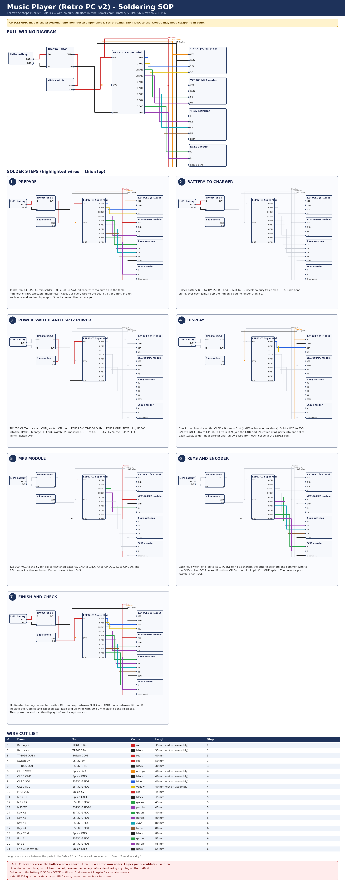

# Music Player (Retro PC v2) - soldering SOP

> GPIO map is the provisional one from docs/components_L_retro_pc.md. ESP TX/RX to the YX6300 may need swapping in code.

## Steps
1. **PREPARE** - Tools: iron 330-350 C, thin solder + flux, 28-30 AWG silicone wire (colours as in the table), 1.5 mm heat-shrink, tweezers, multimeter, tape. Cut every wire to the cut list, strip 2 mm, pre-tin each wire end and each pad/pin. Do not connect the battery yet.
2. **BATTERY TO CHARGER** - Solder battery RED to TP4056 B+ and BLACK to B-. Check polarity twice (red = +). Slide heat-shrink over each joint. Keep the iron on a pad no longer than 3 s.
3. **POWER SWITCH AND ESP32 POWER** - TP4056 OUT+ to switch COM; switch ON pin to ESP32 5V; TP4056 OUT- to ESP32 GND. TEST: plug USB-C into the TP4056 (charge LED on), switch ON, measure OUT+ to OUT- = 3.7-4.2 V, the ESP32 LED lights. Switch OFF.
4. **DISPLAY** - Check the pin order on the OLED silkscreen first (it differs between modules). Solder VCC to 3V3, GND to GND, SDA to GPIO8, SCL to GPIO9. Join the GND and 3V3 wires of all parts into one splice each (twist, solder, heat-shrink) and run ONE wire from each splice to the ESP32 pad.
5. **MP3 MODULE** - YX6300: VCC to the 5V pin splice (switched battery), GND to GND, RX to GPIO21, TX to GPIO20. The 3.5 mm jack is the audio out. Do not power it from 3V3.
6. **KEYS AND ENCODER** - Each key switch: one leg to its GPIO (K1 to K4 as shown), the other legs share one common wire to the GND splice. EC11: A and B to their GPIOs, the middle pin C to GND splice. The encoder push switch is not used.
7. **FINISH AND CHECK** - Multimeter, battery connected, switch OFF: no beep between OUT+ and GND, none between B+ and B-. Insulate every splice and exposed pad, tape or glue wires with 30-50 mm slack so the lid closes. Then power on and test the display before closing the case.

## Wire cut list
| # | From | To | Colour | Length | Step |
|---|---|---|---|---|---|
| 1 | Battery + | TP4056 B+ | red | 35 mm (set on assembly) | 2 |
| 2 | Battery - | TP4056 B- | black | 35 mm (set on assembly) | 2 |
| 3 | TP4056 OUT+ | Switch COM | red | 40 mm | 3 |
| 4 | Switch ON | ESP32 5V | red | 50 mm | 3 |
| 5 | TP4056 OUT- | ESP32 GND | black | 30 mm | 3 |
| 6 | OLED VCC | Splice 3V3 | orange | 40 mm (set on assembly) | 4 |
| 7 | OLED GND | Splice GND | black | 40 mm (set on assembly) | 4 |
| 8 | OLED SDA | ESP32 GPIO8 | blue | 40 mm (set on assembly) | 4 |
| 9 | OLED SCL | ESP32 GPIO9 | yellow | 40 mm (set on assembly) | 4 |
| 10 | MP3 VCC | Splice 5V | red | 45 mm | 5 |
| 11 | MP3 GND | Splice GND | black | 45 mm | 5 |
| 12 | MP3 RX | ESP32 GPIO21 | green | 45 mm | 5 |
| 13 | MP3 TX | ESP32 GPIO20 | purple | 45 mm | 5 |
| 14 | Key K1 | ESP32 GPIO0 | green | 80 mm | 6 |
| 15 | Key K2 | ESP32 GPIO1 | purple | 80 mm | 6 |
| 16 | Key K3 | ESP32 GPIO3 | cyan | 80 mm | 6 |
| 17 | Key K4 | ESP32 GPIO4 | brown | 80 mm | 6 |
| 18 | Key COM | Splice GND | black | 80 mm | 6 |
| 19 | Enc A | ESP32 GPIO5 | green | 55 mm | 6 |
| 20 | Enc B | ESP32 GPIO6 | purple | 55 mm | 6 |
| 21 | Enc C (common) | Splice GND | black | 55 mm | 6 |
