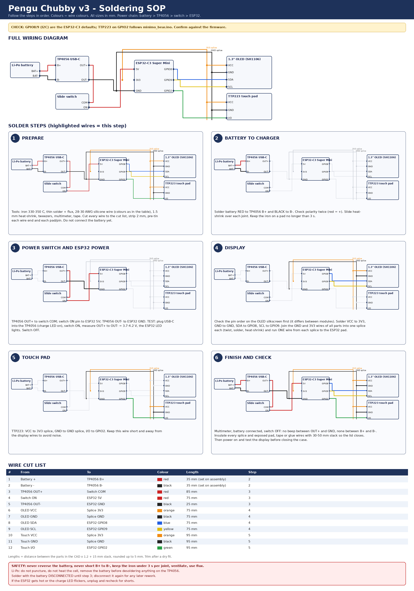

# Pengu Chubby v3 - soldering SOP

> GPIO8/9 (I2C) are the ESP32-C3 defaults; TTP223 on GPIO2 follows minimo_bear.ino. Confirm against the firmware.

## Steps
1. **PREPARE** - Tools: iron 330-350 C, thin solder + flux, 28-30 AWG silicone wire (colours as in the table), 1.5 mm heat-shrink, tweezers, multimeter, tape. Cut every wire to the cut list, strip 2 mm, pre-tin each wire end and each pad/pin. Do not connect the battery yet.
2. **BATTERY TO CHARGER** - Solder battery RED to TP4056 B+ and BLACK to B-. Check polarity twice (red = +). Slide heat-shrink over each joint. Keep the iron on a pad no longer than 3 s.
3. **POWER SWITCH AND ESP32 POWER** - TP4056 OUT+ to switch COM; switch ON pin to ESP32 5V; TP4056 OUT- to ESP32 GND. TEST: plug USB-C into the TP4056 (charge LED on), switch ON, measure OUT+ to OUT- = 3.7-4.2 V, the ESP32 LED lights. Switch OFF.
4. **DISPLAY** - Check the pin order on the OLED silkscreen first (it differs between modules). Solder VCC to 3V3, GND to GND, SDA to GPIO8, SCL to GPIO9. Join the GND and 3V3 wires of all parts into one splice each (twist, solder, heat-shrink) and run ONE wire from each splice to the ESP32 pad.
5. **TOUCH PAD** - TTP223: VCC to 3V3 splice, GND to GND splice, I/O to GPIO2. Keep this wire short and away from the display wires to avoid noise.
6. **FINISH AND CHECK** - Multimeter, battery connected, switch OFF: no beep between OUT+ and GND, none between B+ and B-. Insulate every splice and exposed pad, tape or glue wires with 30-50 mm slack so the lid closes. Then power on and test the display before closing the case.

## Wire cut list
| # | From | To | Colour | Length | Step |
|---|---|---|---|---|---|
| 1 | Battery + | TP4056 B+ | red | 35 mm (set on assembly) | 2 |
| 2 | Battery - | TP4056 B- | black | 35 mm (set on assembly) | 2 |
| 3 | TP4056 OUT+ | Switch COM | red | 85 mm | 3 |
| 4 | Switch ON | ESP32 5V | red | 75 mm | 3 |
| 5 | TP4056 OUT- | ESP32 GND | black | 25 mm | 3 |
| 6 | OLED VCC | Splice 3V3 | orange | 75 mm | 4 |
| 7 | OLED GND | Splice GND | black | 75 mm | 4 |
| 8 | OLED SDA | ESP32 GPIO8 | blue | 75 mm | 4 |
| 9 | OLED SCL | ESP32 GPIO9 | yellow | 75 mm | 4 |
| 10 | Touch VCC | Splice 3V3 | orange | 95 mm | 5 |
| 11 | Touch GND | Splice GND | black | 95 mm | 5 |
| 12 | Touch I/O | ESP32 GPIO2 | green | 95 mm | 5 |
